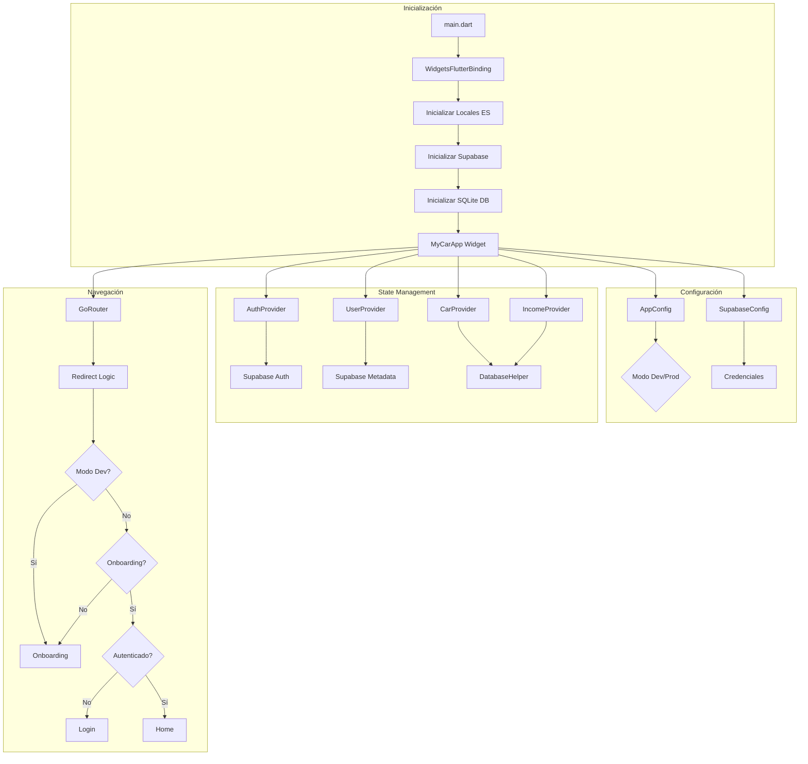
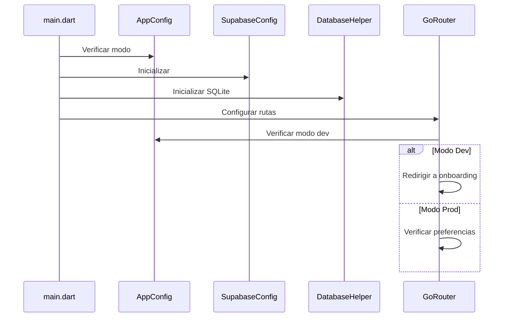
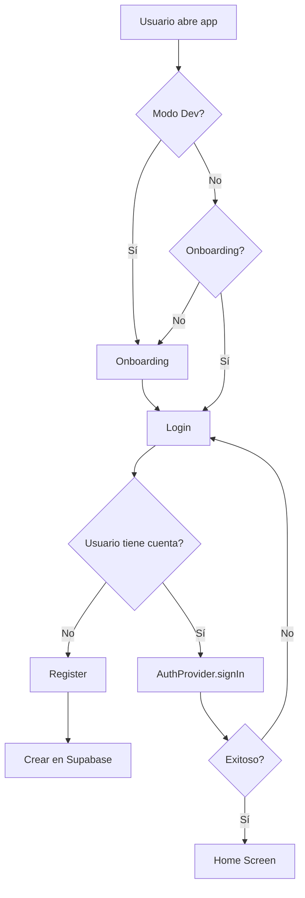
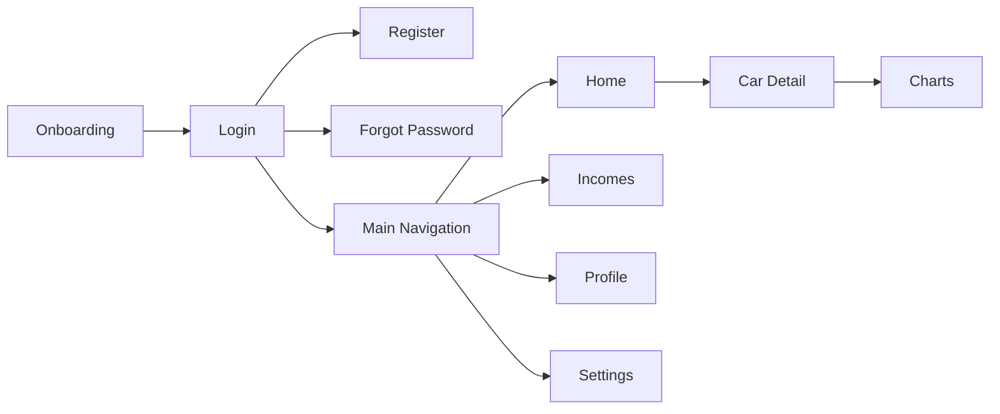

# Diagrama de Arquitectura - MyCar App

## Arquitectura General

## Flujo de Inicialización

## Flujo de Autenticación

## Navegación Principal

## Componentes Principales

### Providers
- AuthProvider: Autenticación Supabase
- UserProvider: Datos usuario (Supabase + SQLite)
- CarProvider: Vehículos (SQLite)
- IncomeProvider: Ingresos (SQLite)
- AppProvider: Tema/Config

### Servicios
- DatabaseHelper: SQLite local
- SupabaseConfig: Cliente Supabase

### Modelos
- Car, Income, User

### Configuración
- AppConfig: Dev/Prod mode
- MyCarColors: Paleta colores
- AppTheme: Temas

## Notas

1. Base de Datos Dual: SQLite local + Supabase
2. Modo Dev: Onboarding siempre visible
3. Modo Prod: Onboarding solo primera vez
4. Navegación: GoRouter con redirect condicional
